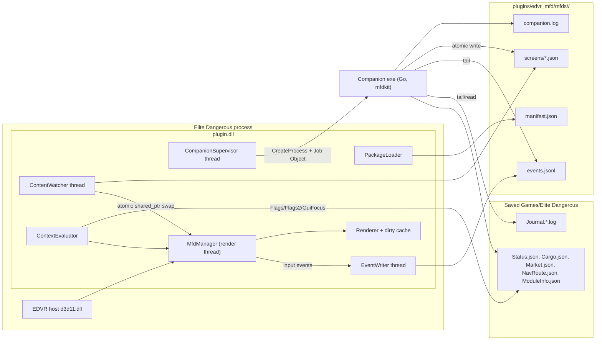
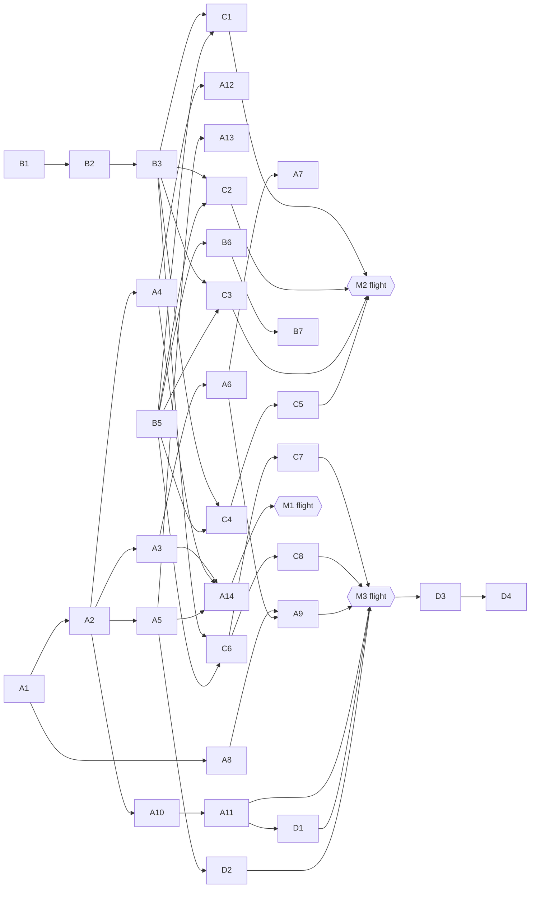

# EDVR MFD v1.0 — Release Design

- **Status**: Approved for spec/ticketing
- **Date**: 2026-10-15
- **Decision record**: [ADR-0001](../adr/ADR-0001-mfd-package-platform.md)
- **Audience**: spec writer and implementing sub-agents. Every section is written so a ticket can cite it directly (`§N.M`).

---

## 1. Goals and non-goals

### Goals (release gate)
| # | Goal | Verified by |
|---|---|---|
| G1 | Unlimited user-imported MFD packages; up to 16 visible screens at once | §13 harness + M1 flight |
| G2 | External apps update screens in real time (< 100 ms write→frame) | §13 harness (latency assert) + M1 flight |
| G3 | Per-package event log of pilot input that apps can react to | §13 harness + replay |
| G4 | Correct visibility across game contexts (ship, SRV, fighter, on foot, docked, maps, FSS/SAA, menus) | gating truth-table test + M1 flight |
| G5 | All F8 Plugins menu entries work and persist | §9 checklist + M3 flight |
| G6 | Three fully live example packages: Ship, Exploration, Route | Go golden tests + replay + M2/M3 flights |
| G7 | Docs match code (authoring guide, schemas, README) | doc review ticket |

### Non-goals (v1.0)
- No runtime network calls by plugin or bundled companions.
- No in-VR text entry.
- No pipe/socket push API (file contract only; may come in v1.x).
- No scripted (Option B / `ScriptedMfdProvider`) providers.
- No free-form layout / images in displays.

---

## 2. Current state (baseline, 2026-10-15)

| Area | Today | Gap |
|---|---|---|
| Content | 3 screens hardcoded as C++ string literals in `MfdManager::ensureDefaultSlots()` (`src/mfd_manager.cpp` ~L560–800) | Must be file/package driven |
| Count | F8 CHOICE "Active displays 1/2/3" | Unlimited packages, cap 16 visible |
| Data | `readEliteStatus()` reads `Status.json` Flags/pips/fuel/cargo on render thread (50 ms cache) | Plugin should read only Flags/Flags2/GuiFocus (+Lat/Long not needed); domain data → companions |
| Parser | `SimpleJsonParser` in `src/mfd_provider.cpp` | Replace with nlohmann/json |
| Events | None (`events.jsonl` documented but not implemented) | Implement §6 |
| Gating | `isActivityActive()` reads `Flags` only; on-foot counts as ship; comments in `mfd_types.h` cite wrong bit numbers | Implement §7 |
| Settings tab | `handleSettingsAdjustment()` keyed on `slot.name`, base size hardcoded per name | Generalize per screen |
| Persistence | INI keyed by slot name (`main_mfd`, …) | Key by `<package_id>/<screen_id>`, migrate |
| Rendering | Re-raster every frame | Dirty-flag (§10) |

---

## 3. Architecture



### 3.1 Threads
| Thread | Owns | Must never |
|---|---|---|
| Render (host `onUpdate`/`onRenderEye`) | `MfdManager`, slots, raster, D3D draw, input routing | Touch disk, parse JSON, spawn processes, block on locks held > 1 µs |
| ContentWatcher | Directory watch, debounce, read, parse, validate, build `MfdViewModel` | Touch D3D or slot state directly |
| CompanionSupervisor | CreateProcess, Job Object, restart backoff, status | Block render thread |
| EventWriter | Lock-free/mutex queue → file append, roll | Drop events silently (log overflow count instead) |
| StatusReader (may be folded into ContentWatcher) | Read `Status.json` on change → publish `GameContext` atomically | — |

Cross-thread handoff uses `std::atomic<std::shared_ptr<const T>>` (C++20) or a mutex-guarded `shared_ptr` swap with the lock held only for the pointer copy.

### 3.2 Source layout (new/changed)
```
src/
  mfd_package.h/.cpp        Manifest model + loader + validation (§4)
  mfd_content_watcher.h/.cpp Watcher thread + debounce + publish (§5)
  mfd_display_schema.h/.cpp  nlohmann → MfdViewModel, schema v1 (§5.3)
  mfd_event_log.h/.cpp       EventWriter thread, per-package files (§6)
  mfd_context.h/.cpp         Status.json → GameContext, context matching (§7)
  mfd_companion.h/.cpp       Supervisor, Job Object, backoff (§8)
  mfd_settings_tab.h/.cpp    Injected SETTINGS tab + pose overrides (§9.3)
  mfd_manager.*              Slots become Screens; ensureDefaultSlots deleted
  mfd_renderer.*             checks, bars, icons, palette, dirty cache (§5.3, §10)
  mfd_provider.*             DeclarativeMfdProvider consumes published models; SimpleJsonParser removed
third_party/nlohmann/json.hpp  vendored, MIT, pinned version noted in header
docs/schema/manifest.v1.schema.json
docs/schema/display.v1.schema.json
companion/                   Go module (§11)
packages/ship|exploration|route/  source of example package folders (manifest + seed screens)
```

---

## 4. Package model

### 4.1 Layout on disk
```
<game>\plugins\edvr_mfd\
  plugin.dll
  mfds\
    <package_id>\
      manifest.json        static; author-owned; never written by plugin
      screens\<screen_id>.json   live; written atomically by companion (seed shipped)
      bin\...              optional companion binaries
      events.jsonl         written by plugin (§6)
      events.1.jsonl       rolled
      companion.log        companion stdout/stderr (truncated per session)
```
`package_id`: `^[a-z0-9][a-z0-9_-]{1,31}$`, must equal folder name (mismatch → package rejected, logged).

### 4.2 `manifest.json` (v1)
```json
{
  "manifestVersion": 1,
  "id": "ship",
  "name": "Ship Readout",
  "version": "1.0.0",
  "author": "EDVR MFD",
  "description": "Module integrity, power and cargo.",
  "minPluginVersion": "1.0.0",
  "screens": [
    {
      "id": "modules",
      "file": "screens/modules.json",
      "title": "MODULES",
      "pose": { "position": [-0.45, -0.22, -0.48], "pitchDeg": -22, "yawDeg": 32, "widthM": 0.24, "heightM": 0.16 },
      "contexts": ["ship_cockpit", "fighter"],
      "excludeContexts": [],
      "autoHideUntilGaze": false
    }
  ],
  "companions": [
    {
      "id": "ship-feed",
      "exe": "bin/edvr-mfd-ship.exe",
      "args": [],
      "env": {},
      "restart": "on-failure"
    }
  ]
}
```
Rules:
- `exe` must resolve inside the package folder **or** be an absolute path (for apps like EDEngineer that run their own updater). Relative paths escaping the package (`..`) are rejected.
- `pose` optional → auto-layout (§9.4).
- `contexts` optional → default set (§7.3).
- Unknown fields ignored (forward compatible); unknown `manifestVersion` major → package rejected.
- Packages are discovered **once at plugin init** (F8 settings can only register then). Manifest edits require restart; screen content hot-reloads.
- Load order: package id ascending, then manifest screen order. This order is the priority for the 16-screen cap (§10.2).

### 4.3 Validation & errors
Rejections are logged to `edvr_mfd.log` with path + reason and, when the package folder is writable, emitted as `load_error` in that package's `events.jsonl`.

---

## 5. Live content reload

### 5.1 Watcher
- `ReadDirectoryChangesW` on `mfds\` recursive, filter `FILE_NOTIFY_CHANGE_LAST_WRITE | FILE_NAME`. Map path → `(package, screen)` via manifest `file`.
- Fallback poll every 500 ms comparing `(mtime, size)` for every registered screen file (covers network drives, missed notifications, overflowed buffers).
- Debounce 30 ms per file; then read with `FILE_SHARE_READ|WRITE|DELETE`, retry ×3 at 10 ms on sharing violation.
- Authors must write atomically (temp file + `MoveFileEx(REPLACE_EXISTING)`); `mfdkit` does this. Non-atomic writes are tolerated: a parse failure on a partial file is retried on the next notification before raising `load_error` (raise only if the same mtime fails twice).

### 5.2 Publish
- Parse → validate → build `std::shared_ptr<const MfdViewModel>` → atomic store into the screen's `pending` slot + bump generation.
- Render thread on each `update()`: if generation changed, swap in, **restore cursor** by `(tab.id, item.id)`; if item gone, clamp index; if tab gone, select tab 0. Mark dirty.
- On failure: keep last good model; set `errorBadge = "ERR"`; emit `load_error {file, line, column, message}` (nlohmann `parse_error.byte` → line/col computed by scanning).

### 5.3 Display schema v1 (`screens/*.json`)
```json
{
  "schemaVersion": 1,
  "title": "MODULES",
  "subtitle": "INTEGRITY",
  "statusBadge": { "text": "2 DAMAGED", "color": "warn" },
  "footerHint": "SELECT: DETAILS",
  "tabs": [
    {
      "id": "integrity",
      "title": "INTEGRITY",
      "type": "list",
      "items": [
        {
          "id": "slot_fsd",
          "label": "Frame Shift Drive",
          "sublabel": "5A",
          "value": "87%",
          "valueColor": "warn",
          "icon": "warning",
          "checks": [ { "label": "S", "state": "done" }, { "label": "M", "state": "todo" } ],
          "action": "event"
        }
      ]
    },
    {
      "id": "pips",
      "title": "POWER",
      "type": "bars",
      "items": [ { "id": "sys", "label": "SYS", "value": 4, "max": 8, "segments": 8, "color": "accent" } ]
    },
    { "id": "kv", "title": "INFO", "type": "keyvalue", "items": [ { "id": "hull", "key": "Hull", "value": "100%", "valueColor": "ok" } ] },
    { "id": "about", "title": "ABOUT", "type": "text", "text": "Multi-line\ntext" }
  ]
}
```
| Element | Spec |
|---|---|
| `schemaVersion` | Required. Major ≠ 1 → refuse + `load_error`. |
| Tab types | `list`, `keyvalue`, `text`, **`bars`** (new). |
| `id` | Required on tabs and on list/keyvalue/bars items; unique within parent. Missing → `load_error` (file refused). |
| Colors | Named palette only: `normal`, `dim`, `accent`, `ok`, `warn`, `crit`. Resolved through the screen's theme so user color modes still apply. |
| `checks` | 0–6 entries `{label: 1–2 chars, state: done|todo|na}`; drawn as small boxes left of label (filled = done, outline = todo, dashed/dim = na). |
| `icon` | Fixed glyph set: `fuel`, `warning`, `neutron`, `whitedwarf`, `bio`, `geo`, `check`, `lock`, `star`. Unknown → ignored with a one-time log line. |
| `action` | `event` (default; emits `select`) or `clipboard` (copies `value` if present else `label`, and also emits `select` with `action:"clipboard"`). |
| Limits | ≤ 16 tabs, ≤ 256 items/tab, strings truncated at 128 chars, file ≤ 1 MB. Overflow → truncate + one-time warn. |
| Injected tab | Plugin appends `SETTINGS` (§9.3); authors must not use tab id `__settings`. |

Publish JSON Schema (draft 2020-12) for manifest and display in `docs/schema/`, referenced via `"$schema"` in example files.

---

## 6. Event log

### 6.1 File
- `mfds/<id>/events.jsonl`, UTF-8, one JSON object per line, `\n` terminated, flushed per batch (≤ 50 ms latency).
- Truncated at plugin init (new session). When > 1 MB → rename to `events.1.jsonl` (replacing old) and start fresh.
- Opened with `FILE_SHARE_READ | FILE_SHARE_DELETE` so tailers can read/rotate.

### 6.2 Record
```json
{"seq":42,"ts":"2026-10-15T14:53:01.123Z","session":"7f3c…","screen":"modules","type":"select","tab":"integrity","index":3,"itemId":"slot_fsd","label":"Frame Shift Drive","key":null,"delta":null}
```
| Field | Notes |
|---|---|
| `seq` | Monotonic per package per session, starts at 1. |
| `session` | UUIDv4 generated at plugin init; also passed to companions as `EDVR_MFD_SESSION`. |
| `type` | `plugin_start`, `screen_loaded`, `load_error`, `context_changed`, `focus_gained`, `focus_lost`, `tab_change`, `nav`, `select`, `adjust`, `companion_started`, `companion_crashed`, `companion_gave_up`. |
| Extra fields | `load_error`: `file,line,column,message`. `context_changed`: `contexts[]`, `flags`, `flags2`, `guiFocus`. `adjust`: `key`, `delta` (±1). `select`: optional `action`. `companion_*`: `companion`, `pid`, `exitCode`, `attempt`. |

Events on the injected SETTINGS tab are **not** emitted (user config, not app input).

### 6.3 Writer
Render thread pushes small structs into a bounded MPSC queue (capacity 4096). Writer thread serializes + appends. On overflow, drop oldest `nav` first; count drops and emit one `events_dropped {count}` record.

---

## 7. Game-context gating

### 7.1 Inputs (from `Status.json`, read by plugin on change, not per frame)
`Flags` (u32), `Flags2` (u32, Odyssey), `GuiFocus` (int). Missing file or `Flags==0 && Flags2==0` → `main_menu`.

### 7.2 Context vocabulary
| Context | Rule |
|---|---|
| `main_menu` | Status missing/empty or Flags==0 && Flags2==0 |
| `ship_cockpit` | Flags bit 24 (InMainShip) |
| `fighter` | Flags bit 25 |
| `srv` | Flags bit 26 |
| `on_foot` | Flags2 bit 0 |
| `taxi` | Flags2 bit 1 |
| `multicrew` | Flags2 bit 2 |
| `docked` | Flags bit 0 |
| `landed` | Flags bit 1 |
| `supercruise` | Flags bit 4 |
| `normal_space` | in vehicle && !supercruise && !docked && !landed |
| `hardpoints` | Flags bit 6 |
| `analysis_mode` | Flags bit 27 |
| `combat_mode` | in ship && !bit 27 |
| `galaxy_map` | GuiFocus 6 |
| `system_map` | GuiFocus 7 |
| `orrery` | GuiFocus 8 |
| `fss` | GuiFocus 9 |
| `saa` | GuiFocus 10 |
| `codex` | GuiFocus 11 |
| `station_services` | GuiFocus 5 |
| `paused` | reserved, set only if MFD-006 spike finds a signal |

### 7.3 Matching
Visible iff `(contexts ∩ active) ≠ ∅` **and** `(excludeContexts ∩ active) = ∅` **and** no member of the **global exclusion set** is active unless the screen lists it explicitly in `contexts`.
- Default `contexts` = `[ship_cockpit, fighter, srv, on_foot, taxi, multicrew]`.
- Global exclusion set = `[main_menu, galaxy_map, system_map, orrery, fss, saa, codex, paused]`. (Fixes MFD-003.)
- A transition emits `context_changed` to every package whose visibility changed.
- Delete `kActivity*` bitmask and `isActivityActive()`; fix incorrect bit comments in `mfd_types.h`.

### 7.4 MFD-006 (pause menu) — "Hide All" Setting Button
Per user decision, do not spend time reverse-engineering pause menu state. MFD-006 is addressed directly by providing an explicit **"Hide All"** toggle button in the F8 Plugins menu settings (under Cockpit MFD: `mfd_hide_all_toggle`), plus an optional configurable hotkey in `edvr_mfd.ini`. When active, all MFD quad rendering and eye blitting is bypassed immediately, allowing the pilot to clear the cockpit view during pause/ESC menus or when MFDs are obstructive.

---

## 8. Companion supervision

### 8.1 Launch
- On init, after packages load and settings register, for each package with `Run companions = on`: `CreateProcessW` with `CREATE_NO_WINDOW | CREATE_SUSPENDED`, assign to a single plugin-wide Job Object with `JOB_OBJECT_LIMIT_KILL_ON_JOB_CLOSE`, then resume.
- `cwd` = package folder. stdout/stderr → `companion.log` (inheritable handle, truncated per session).
- Environment (added to inherited env):
  | Var | Value |
  |---|---|
  | `EDVR_MFD_PACKAGE_DIR` | absolute package folder |
  | `EDVR_MFD_JOURNAL_DIR` | Saved Games Elite dir (or the plugin's own override, §13.2) |
  | `EDVR_MFD_SESSION` | session UUID (§6.2) |
  | `EDVR_MFD_EVENTS` | absolute path of `events.jsonl` |
  | `EDVR_MFD_PLUGIN_VERSION` | e.g. `1.0.0` |
- Log exe path + SHA-256 + pid to `edvr_mfd.log`.
- Absolute-path companions that are already running (e.g. app with own updater) are allowed to fail fast; a companion may hold a named mutex `Local\edvr_mfd_<package_id>_<companion_id>` and exit 0 if taken. Exit code 0 is treated as "intentional, do not restart".

### 8.2 Restart policy
Non-zero exit → restart after 1 s, 5 s, 30 s, 30 s…; if 5 crashes within 10 min → `companion_gave_up`, stop. Each crash → `companion_crashed` event + log line. While not running, package screens show status badge `COMPANION OFFLINE` (overrides content badge, color `crit`).

### 8.3 Toggling
`Run companions` off at runtime → terminate that package's processes (`TerminateProcess`, then they're out of the job), clear OFFLINE badge (screens show last content with badge `PAUSED`). On → launch, reset crash counters.

### 8.4 Shutdown
`mfdPluginShutdown()` closes the Job handle (kills all), stops threads (watcher, supervisor, writer — join with 500 ms timeout), then `Log::close()`. No CRT stdio anywhere (`/MT` constraint).

---

## 9. F8 menu, settings, poses

### 9.1 Global entries (header `Cockpit MFD`)
| Key | Type | Default | Behavior |
|---|---|---|---|
| `cockpit_mfd_enabled` | BOOL | 1 | Master enable; off = no render, no input swallow, companions keep running |
| `mfd_show_all` | BOOL | 1 | Disables gaze fade on all screens (MFD-007 semantics) |
| `mfd_head_locked` | BOOL | 0 | Head-locked HUD for all screens |
| `mfd_hide_all_toggle` | BOOL | 0 | "Hide All" toggle; immediately suppresses all MFD display rendering (MFD-006) |

Remove `mfd_display_count`.

### 9.2 Per-package entries (header `MFD: <name>`; one block per package found at init)
| Key | Type | Default | Hint |
|---|---|---|---|
| `pkg.<id>.show` | BOOL | 1 | Show this package's screens |
| `pkg.<id>.companions` | BOOL | 1 | Run companions; hint text includes last known status if the host re-reads hint (else static text) |

Getters/setters may be called from the host menu thread → backing fields are `std::atomic<bool>`; side effects (companion start/stop) are posted to the supervisor thread.

All F8 values persist in `%LOCALAPPDATA%\EDVR\edvr_mfd.ini` and round-trip across restarts.

### 9.3 Injected SETTINGS tab
Generalize the current in-MFD settings (`handleSettingsAdjustment`) to every screen: Tracking Mode, Position X/Y/Z, Pitch, Yaw, Display Scale, Glass Opacity, Color Mode, **Reset Pose**. Base width/height come from the manifest pose (not hardcoded by slot name). Saved as INI section `[<package_id>/<screen_id>]`.

### 9.4 Auto-layout
Screens without a manifest pose are placed on an arc at radius 0.55 m, y = −0.22 m, pitch −22°, yaw slots at 0°, ±32°, ±64°; second row at y = −0.02 m, pitch −10°. Allocation in load order, skipping angles already used by explicit poses (±8° tolerance).

### 9.5 Migration
On first load, if INI sections `main_mfd`/`left_mfd`/`right_mfd` exist and the target sections don't: copy to `route/route`, `ship/power`, `exploration/bio` respectively; then delete old sections; log once.

---

## 10. Performance

### 10.1 Rendering
- Per screen, keep a CPU raster buffer + GPU texture; re-raster/upload only when dirty (model swap, focus change, cursor/tab change, theme/opacity change, badge change, alpha crossing 0).
- Skip raster and draw for screens that are hidden, context-gated, package-hidden, or alpha == 0.
- Allocate render textures lazily on first visible frame; release when package hidden > 10 s or disabled.

### 10.2 Cap
Hard cap of **16 visible screens**. Selection: focused screen always included; remaining by load order (§4.2). Exceeding the cap logs once per session: `mfd: visible cap 16 reached, N screens suppressed (<ids>)`.

### 10.3 Budget & telemetry
- Budget: plugin render-thread CPU p95 < 0.5 ms with 12 visible screens, 1 dirty per frame.
- Measure with QPC around `update()+render()+renderToEyeRtv()`; log rolling p50/p95/max and visible/dirty counts every 60 s.

---

## 11. Companions & SDK (Go)

### 11.1 Module layout
```
companion/
  go.mod                         module github.com/dmnemec/edvr-mfd/companion
  pkg/mfdkit/
    display/   typed schema v1 structs + palette/icon constants + Validate()
    writer/    WriteScreen(path, Display) atomic temp+rename, skip if bytes unchanged
    events/    Tail(path) → chan Event; handles truncation/roll, session change, seq gaps
    elite/     Journal tailer (newest Journal.*.log, follows rollover), typed events used below;
               file watchers for Status/Cargo/Market/NavRoute/ModuleInfo; dir from EDVR_MFD_JOURNAL_DIR
    env/       reads EDVR_MFD_* vars, single-instance mutex helper
    replay/    session recorder/replayer (§13.2)
  cmd/ship/          → packages/ship/bin/edvr-mfd-ship.exe
  cmd/exploration/   → packages/exploration/bin/edvr-mfd-exploration.exe
  cmd/route/         → packages/route/bin/edvr-mfd-route.exe
  cmd/mfdkit/        → CLI: `mfdkit replay`, `mfdkit validate <pkg>`, `mfdkit record`
  internal/data/     bundled static tables (embed.FS)
  testdata/          recorded Journal/Status fixtures + golden screen JSON
```
### 11.2 Companion behavior contract (all three)
- On start: replay today's Journal from the most recent `LoadGame`/`Location` forward to rebuild state, then tail.
- Write screens only when content changes (byte compare).
- Coalesce bursts: max 1 write per screen per 100 ms (Status.json changes up to several times/s).
- Tail own `events.jsonl`; react to `select`/`adjust` per screen spec.
- Exit 0 on `EDVR_MFD_SESSION` mismatch with events file session (stale instance) or on mutex taken.
- Never crash on unknown Journal events/fields; log and continue.

### 11.3 Build
`build.bat` (after plugin build) runs:
```
wsl -- bash -lc "cd /mnt/c/.../edvr-mfd/companion && GOOS=windows GOARCH=amd64 /usr/local/go/bin/go build -trimpath -ldflags=-s -o ../packages/<pkg>/bin/<exe> ./cmd/<pkg>"
```
for each companion and `go test ./...`; any failure → non-zero exit of `build.bat`.

---

## 12. Example packages

General: all screens use schema v1, have stable ids, and ship a **seed** JSON (shown before companion's first write) with a "WAITING FOR DATA" badge.

### 12.1 Ship (`ship`) — 3 screens, order: MODULES, POWER, CARGO
Default contexts: `ship_cockpit`, `fighter` (CARGO also `docked`).

**MODULES** (first/primary)
- Source: Journal `Loadout` (Modules[].Slot/Item/Health/On/Priority, HullHealth), `HullDamage`, `AfmuRepairs`, `Repair`, `RepairAll`, `RebootRepair`, `ModuleSwap/Buy/Sell/Store/Retrieve`.
- List tab `integrity`: one row per module, label = localized module name (bundled item-name table, fallback to cleaned `Item`), sublabel = class/rating + slot, value = health %, color ok ≥ 80, warn 40–79, crit < 40; `icon: warning` when < 80 or `On:false`. Sort: damaged (health < 100) first ascending, then by slot group (core → optional → hardpoints → utility).
- Header row / keyvalue tab `hull`: Hull %, modules damaged count; badge `N DAMAGED` (warn/crit) or `NOMINAL` (ok).
- Updates only when integrity changes (accepted freshness limitation, documented).
- `select` on a module → no in-game effect; companion may show a detail keyvalue (slot, item, health, priority, power).

**POWER**
- Sources: `Status.json` Pips `[sys,eng,wep]` (half-pips), Fuel `{FuelMain, FuelReservoir}`, Flags bit 20 Overheating, bit 19 LowFuel; `ModuleInfo.json` (Power draw, Priority per slot); `Loadout` (FuelCapacity, MaxJumpRange, power plant item + Engineering `PowerCapacity` modifier).
- `bars` tab `pips`: SYS/ENG/WEP value 0–8 half-pips, max 8.
- `bars` tab or rows: Power draw vs capacity (MW) — capacity from bundled power-plant table by `Item` overridden by Engineering `PowerCapacity` modifier if present; Fuel main vs capacity; Reservoir.
- `keyvalue`: Max jump range (Loadout, unladen), Overheating (crit when set) — **note: ship heat % is not exposed in Status.json; v1 shows the Overheating flag instead of a percentage**.
- `list` tab `priorities`: modules grouped by priority 1–5 with draw and on/off icon.

**CARGO**
- Sources: `Cargo.json` (Inventory[] Name/Name_Localised/Count/Stolen), `Loadout.CargoCapacity`, `Market.json` Items[] `MeanPrice`.
- Header/keyvalue: `Used / Max` (e.g. `64 / 128 T`) plus a capacity bar; total estimated value = Σ count × MeanPrice over known prices, suffix `+` if any unknown.
- List: commodity, count, value = galactic average **MeanPrice** (never Buy/Sell price), `icon: lock` if stolen; unknown mean → value `—`, color `dim`.
- Price cache: `%LOCALAPPDATA%\EDVR\mfd-companion\mean_prices.json`, updated from every `Market.json` read (MeanPrice only). No seed table, no network.

### 12.2 Exploration (`exploration`) — 2 screens: SYSTEM, BIO
Default contexts: the §7.3 default set (all vehicles + `on_foot`). FSS/SAA stay globally excluded in v1; showing SYSTEM inside FSS is a candidate v1.x option.

State: keyed by `SystemAddress`; resets view on `FSDJump`/`CarrierJump`/`Location`; persisted per system in `%LOCALAPPDATA%\EDVR\mfd-companion\systems\<SystemAddress>.json` so revisits restore progress.

**SYSTEM**
- Sources: `FSDJump`/`Location`/`CarrierJump` (StarSystem, StarClass via `StartJump`/primary `Scan`, SystemAllegiance, SystemSecurity_Localised, Population), `FSSDiscoveryScan` (BodyCount), `FSSAllBodiesFound`, `Scan` (BodyName, PlanetClass/StarType, DistanceFromArrivalLS, Landable, TerraformState, WasDiscovered, WasMapped, WasFootfalled, ScanType), `SAAScanComplete`, `FSSBodySignals`, `SAASignalsFound`.
- keyvalue tab `overview`: system name, primary star, allegiance, security, population, `Bodies scanned: 7 / 12`, estimated total value.
- list tab `bodies`: one row per body; label short name (strip system prefix); sublabel type + `ls` distance + `LAND`/`TERRA` tags; value = estimated value (scan + map, bundled community formula incl. first-discovery/first-mapped multipliers); **checks** before label:
  - `S` — detailed scan done (Scan with ScanType Detailed/AutoScan detailed data) — `todo` otherwise
  - `M` — mapped by pilot (`SAAScanComplete`) — `na` for stars/belts/non-mappable
  - `B` — biology complete (all species analysed) — `na` if no bio signals; `todo` with bio count in sublabel
  - `G` — geo signals present (`na` if none; `done` informational only)
  Icons: `bio`/`geo` if signals; `star` for stars. Sort by value desc; unscanned (from BodyCount gap) shown as trailing `? Unscanned bodies: N`.
- `select` on body → companion writes a detail keyvalue tab `body` (gravity, atmosphere, temp, rings, signals, discovered/mapped flags) and switches nothing else (cursor stays).

**BIO**
- Sources: `FSSBodySignals`/`SAASignalsFound` (bio count, Genuses), `ScanOrganic` (ScanType Log/Sample/Analyse, Genus, Species, Variant, Body), `ApproachBody`/`LeaveBody`/`Touchdown`/`Liftoff`/`Disembark`, `Status.json` Latitude/Longitude/PlanetRadius/BodyName, `SellOrganicData`.
- list tab `bodies`: bodies in current system with bio signals; checks = per-body `B` progress; sublabel `2/4 species done`.
- list tab `current` (default tab when on/near a body): one row per genus (from SAASignalsFound) then species once logged; **checks `L`, `S`, `A`** (Log, Sample 2, Analyse) reflecting ScanOrganic stages; value = species base value × (5 if not previously footfalled/first logged else 1) from bundled species table; badge on the in-progress species.
- keyvalue tab `sample`: live **distance from last sample** — haversine over Lat/Long with PlanetRadius vs bundled colony range for the in-progress genus, e.g. `142 m / 250 m`, color crit < range, ok ≥ range. Updates with Status.json (coalesced 100 ms ⇒ ≤ 10 writes/s for this screen only).
- Bundled tables: species base values, genus colony range, body value formula constants — `internal/data`, versioned, sourced from public community data at authoring time (offline).

### 12.3 Route (`route`) — 1 screen, 2 tabs
Default contexts: `ship_cockpit` (covers supercruise/normal space while in the ship) and `docked`.
- **NAVROUTE** tab: from `NavRoute.json` (Route[] StarSystem/StarClass/StarPos) + `NavRouteClear` + `FSDJump`. Header: jumps remaining, total distance (sum of StarPos deltas), next system. Rows: system, star class; `icon: neutron` for `N`, `whitedwarf` for `D*`, `fuel` for `KGBFOAM` scoopable; current position marked with badge `HERE`, passed rows `dim`. `action: clipboard` on rows.
- **SPANSH** tab: reads optional `route.csv` (Spansh neutron plotter CSV export columns: `System Name, Distance To Arrival, Distance Remaining, Neutron Star, Jumps`) placed in the package folder or path set in `route.ini`. Tracks progress on `FSDJump` matching `StarSystem`; keyvalue toggle row `auto_copy` (adjust/select toggles) → when on, companion copies next waypoint to clipboard on each arrival (companion-side `clipboard` via Win32 from Go). Rows `action: clipboard`. Empty state text explains how to export from spansh.co.uk.

---

## 13. Verification strategy

### 13.1 Layer 1 — Offline (every ticket)
- `tools/mfd_test` gains a **package host harness** (no D3D): loads `tools/mfd_test/fixtures/mfds/`, runs watcher/writer threads, asserts:
  - reload latency < 100 ms (atomic write → published generation),
  - cursor preserved by ids; clamp on removal,
  - `load_error` with correct line/column; last good model retained,
  - event schema/seq/session; roll at 1 MB; truncation at init,
  - context truth table: table of `(Flags, Flags2, GuiFocus) → active contexts → visible?` covering every row of §7.2 and MFD-003 cases,
  - 16-screen cap selection,
  - INI migration (§9.5), pose override round-trip,
  - supervisor backoff using a stub exe that exits non-zero / zero.
- Go: `go test ./...` with `testdata/` Journal fixtures → golden screen JSON per companion; `mfdkit validate` passes on all example packages; JSON Schema validation of seeds.

### 13.2 Layer 2 — Desktop replay (no headset)
- `mfdkit record` captures a Saved Games session (Journal + Status/Cargo/Market/NavRoute/ModuleInfo snapshots with timestamps).
- `mfdkit replay --speed 4x --out <dir>` re-emits into a fake Saved Games dir.
- Plugin + companions honor `EDVR_MFD_JOURNAL_DIR` (plugin reads it from env or ini `journal_dir=`) so the harness + real companions run the full pipeline against replay.
- Required recorded sessions (ticket B7 provides explicit step-by-step pilot instructions):
  1. **Session 1 (Combat Damage & Repair)**: Take module/hull damage in combat or heat, cycle AFM repairs, reboot/repair, and dock for station repair.
  2. **Session 2 (Trading & Commodities)**: Visit a station commodity market (generating `Market.json` MeanPrice records), purchase cargo, undock, and sell.
  3. **Session 3 (Exploration & Exobiology)**: Jump into an unvisited/partially scanned system, honk (`FSSDiscoveryScan`), scan bodies in FSS, map a body with DSS (`SAAScanComplete`), land on foot, use the genetic sampler on 3 organic samples with spacing (`ScanOrganic` Log/Sample/Analyse), and sell data.
  4. **Session 4 (Plotted Route & Jump Progress)**: Plot a multi-hop route in Galaxy Map (writes `NavRoute.json`), execute at least 2 jumps including a neutron star / white dwarf or scoopable KGBFOAM star.
  5. **Session 5 (Context State Transitions)**: Transition between Cockpit -> SRV -> On Foot -> Galaxy Map -> System Map -> Station Services -> Main Menu.

### 13.3 Layer 3 — Test flights (3 only)
Each milestone has a written flight script (steps + exact log lines/events to check) committed under `docs/flights/`.

| Milestone | Scope | Exit criteria |
|---|---|---|
| **M1** Platform | Loader, watcher, schema v1 rendering, events, context gating, supervisor, settings tab, F8 global + per-package | Fixture package edited live on desktop updates in headset; MFD-003 resolved; events observed; companion stub restart observed |
| **M2** Ship + Route | §12.1, §12.3 | Damage → MODULES updates; pips/fuel live; cargo mean prices after market visit; route progress + clipboard |
| **M3** Exploration + polish | §12.2, perf §10, F8 checklist §9, MFD-006 outcome, docs | Bio sample distance live on foot; SYSTEM resets on jump; p95 within budget at 12 screens; all F8 rows pass |

Every ticket's Definition of Done names the layer(s) that verify it.

---

## 14. Work breakdown (ticket seeds)

IDs are provisional; dependencies in brackets.

### Epic A — Platform core (plugin, C++)
| ID | Ticket | Deps | Verify |
|---|---|---|---|
| A1 | Vendor nlohmann/json; replace `SimpleJsonParser`; schema v1 model incl. ids, palette, checks, bars, icons, action, limits | — | L1 |
| A2 | Package discovery + manifest v1 parse/validate (§4) | A1 | L1 |
| A3 | ContentWatcher thread + debounce + atomic publish + cursor restore + ERR badge (§5) | A1, A2 | L1 |
| A4 | EventWriter thread + per-package files + roll + all event types (§6) | A2 | L1 |
| A5 | ContextEvaluator: Status.json reader off render thread, vocabulary, matching, delete `kActivity*` (§7) | A2 | L1 |
| A6 | Screens replace slots in `MfdManager`; delete `ensureDefaultSlots`; load order; auto-layout (§9.4); 16 cap (§10.2) | A2, A3 | L1 |
| A7 | Injected SETTINGS tab generalized + per-screen INI + migration (§9.3, §9.5) | A6 | L1 |
| A8 | Renderer: checks, bars, icons, named palette, status badge overrides | A1 | L1 + M1 |
| A9 | Dirty-flag raster, lazy textures, skip gated, QPC telemetry (§10) | A6, A8 | L1 + M3 |
| A10 | CompanionSupervisor: Job Object, env, logs, backoff, OFFLINE/PAUSED badges, shutdown order (§8) | A2, A4 | L1 (stub exe) |
| A11 | F8: remove display count; per-package Show/Run companions; atomics; persistence (§9.1–9.2) | A6, A10 | L1 + M3 |
| A12 | Input routing emits focus/nav/tab/select/adjust events; clipboard action generalized | A4, A6 | L1 |
| A13 | `EDVR_MFD_JOURNAL_DIR` / ini `journal_dir` override | A5 | L1/L2 |
| A14 | Package-host harness in `mfd_test` + fixtures (§13.1) | A3, A4, A5 | — (is the verifier) |

### Epic B — SDK & tooling (Go)
| ID | Ticket | Deps | Verify |
|---|---|---|---|
| B1 | Go module scaffold, `build.bat` WSL integration, `go test` gate | — | build |
| B2 | `mfdkit/display` structs + Validate + JSON Schema files in `docs/schema/` | A1 (schema agreed) | L1 |
| B3 | `mfdkit/writer` atomic writes, byte-compare, 100 ms coalescing | B2 | L1 |
| B4 | `mfdkit/events` tailer (roll, truncate, session) | — | L1 |
| B5 | `mfdkit/elite` Journal tailer + typed events + file watchers + startup replay | — | L1 |
| B6 | `mfdkit record/replay/validate` CLI | B5 | L2 |
| B7 | Record the 5 fixture sessions (§13.2) — **requires a pilot; schedule with M1 flight** | B6 | — |

### Epic C — Example packages (Go + package files)
| ID | Ticket | Deps | Verify |
|---|---|---|---|
| C1 | Ship: MODULES | B3, B5, A8 | L1 golden, L2, M2 |
| C2 | Ship: POWER (+ power plant table) | B3, B5 | L1, L2, M2 |
| C3 | Ship: CARGO (+ MeanPrice cache) | B3, B5 | L1, L2, M2 |
| C4 | Route: NAVROUTE tab | B3, B5 | L1, L2, M2 |
| C5 | Route: SPANSH CSV tab + auto-copy toggle | C4, B4 | L1, L2, M2 |
| C6 | Exploration: state model + per-system persistence | B5 | L1 |
| C7 | Exploration: SYSTEM screen + body value formula + checks | C6 | L1, L2, M3 |
| C8 | Exploration: BIO screen + species tables + live sample distance | C6 | L1, L2, M3 |
| C9 | Package manifests, seeds, `$schema` refs, `mfdkit validate` clean | C1–C8 | L1 |

### Epic D — Context, host, release
| ID | Ticket | Deps | Verify |
|---|---|---|---|
| D1 | Implement "Hide All" toggle in F8 menu (`mfd_hide_all_toggle`) & ini hotkey fallback (resolves MFD-006) | A11 | L1 + M1 |
| D2 | Context gating validation against Odyssey GuiFocus/Flags/Flags2 truth table | A5 | L1 + M1 |
| D3 | `install_mfd.py`: full layout, version-aware no-overwrite, `--force`, `--dry-run` | C9 | dry-run test |
| D4 | Release zip script + README min host version + host commit pin | D3 | manual |
| D5 | Docs: rewrite authoring guide & architecture to match; ISSUES.md entries (MFD-003 resolution, MFD-006 status, new tracked items per AGENTS.md); confirm AGENTS.md host branch (`feat/third-party-plugins`) | all | review |
| D6 | Flight scripts M1/M2/M3 in `docs/flights/` | A*, C* | — |



Parallelism: Epics A and B can start immediately in parallel; C starts once B3/B5 land (golden tests don't need the plugin). D1 and D2 can proceed once A11 and A5 land.

---

## 15. Risks & open items

| Risk | Mitigation / owner decision |
|---|---|
| AV flags game-spawned unsigned exes | Hash logging, per-package toggle, README guidance; consider code signing post-v1 |
| Status.json write races (partial reads) | Retry on parse failure; Status read off render thread |
| Journal schema drift (Frontier updates) | Companions tolerate unknown fields; plugin unaffected |
| No pause signal (MFD-006) | Spike D1; fallback hotkey + known issue |
| Power plant capacity not in Journal | Bundled table + Engineering modifier override |
| Ship heat % unavailable | Show Overheating flag (deviation from interview draft, documented) |
| Exobio values/colony ranges change | Versioned bundled tables; update in patch releases |
| Host menu re-reads hint text? | If not, per-package status hint is static; status is still visible via badges/logs |
| Host branch naming mismatch in AGENTS.md | Fixed in D5; release pins exact host commit |
